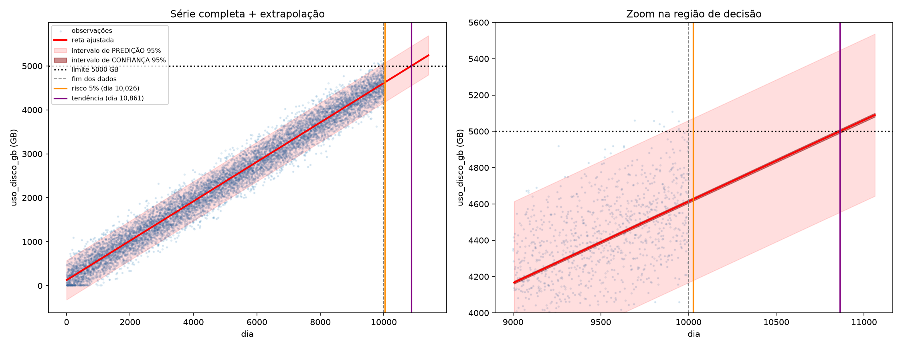

# IC — Introdução aos Paradigmas de Machine Learning
## Professor Marcio Rodrigues Sabino
### Aluno Maurício Jampani de Souza

Iniciação Científica: estudo, implementação própria e avaliação de algoritmos clássicos
de Machine Learning. Em cada modelo, a matemática vem antes do `import`, a implementação
é feita à mão e conferida contra a biblioteca de referência, e os resultados são
explicados com gráficos.

## Modelos

| | Modelo | Estudo | Status |
|---|---|---|---|
| 1 | **Regressão Linear** | [Previsão de esgotamento de disco](regressao_linear/) | ✅ concluído |
| 2 | Regressão Logística | — | em andamento |
| 3 | k-NN | — | |
| 4 | Árvore de Decisão | — | |
| 5 | Random Forest | — | |
| 6 | K-Means | — | |
| 7 | Apriori | — | |
| 8 | PCA | — | |
| 9 | Q-Learning | — | |
| 10 | Detecção de Anomalias | — | |

---

## Curiosidades — o que os dados mostraram e o enunciado não pedia

### Regressão Linear

> **📉 861 dias ou 26 dias?**
> Invertendo a reta, o disco atinge o limite de 5.000 GB em 861 dias. Mas a reta é a
> ocupação *média*, e o disco não estoura na média: estoura num dia concreto. O dia em
> que passa a haver 5% de chance de uma leitura estourar chega em **26 dias**. A mesma
> pergunta, duas respostas, uma ordem de grandeza de diferença. E 9 dias da amostra já
> tinham passado do limite.

> **🧱 Um piso escondido nos dados.**
> 101 dias valem *exatamente* 10,00 GB. Um valor contínuo não se repete 101 vezes por
> acaso: é um corte do gerador, que evitou ocupação negativa no início da série. No
> gráfico de resíduos ele aparece como uma reta descendente, porque ali $e = 10 - \hat y$.

> **🎯 R² = 0,97 e erro de 228 GB, ao mesmo tempo.**
> Não é contradição. O R² mede quanto da variação a reta explica; como o disco sobe
> 4.500 GB ao longo da série, os 3% que sobram ainda são ±228 GB por dia. "1 − R²" não é
> margem de erro.

> **🔢 Estatística que não precisa de dados.**
> O desvio padrão da coluna `dia` (2.886,8957) sai só da fórmula $\sqrt{(n^2-1)/12}$,
> sem olhar o arquivo, e bate nas 12 casas. É a prova de que `dia` é um índice, não uma
> medição.

> **👀 Parecia padrão, não era.**
> A média móvel dos resíduos faz ondas de até ±45 GB que parecem ciclos. Medindo:
> Durbin-Watson = 2,03, e a média móvel oscila 16,09 GB contra 16,10 GB esperados para
> ruído puro. Não há autocorrelação; só o número separou "parece" de "é".

> **🧮 Duas contas, o mesmo resultado até a 10ª casa.**
> As fórmulas $S_{xy}/S_{xx}$ e a forma matricial $C^TC\beta = C^Ty$ vista em aula dão a
> mesma reta. Na forma matricial, a matriz é 2×2 com 4 pontos ou com 10.000; mas o número
> de condição dela sobe de 72 para 130 milhões, e é por isso que bibliotecas evitam
> montar $C^TC$.
