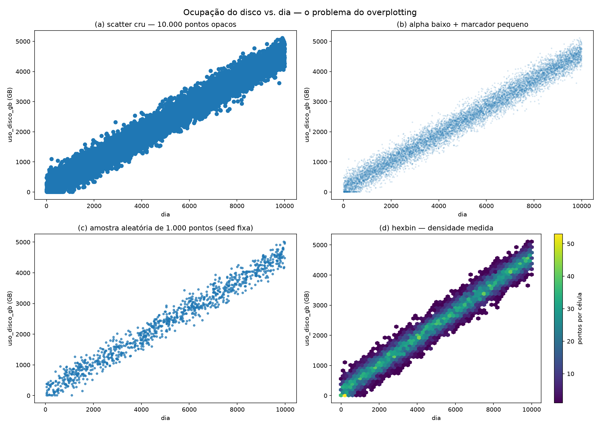
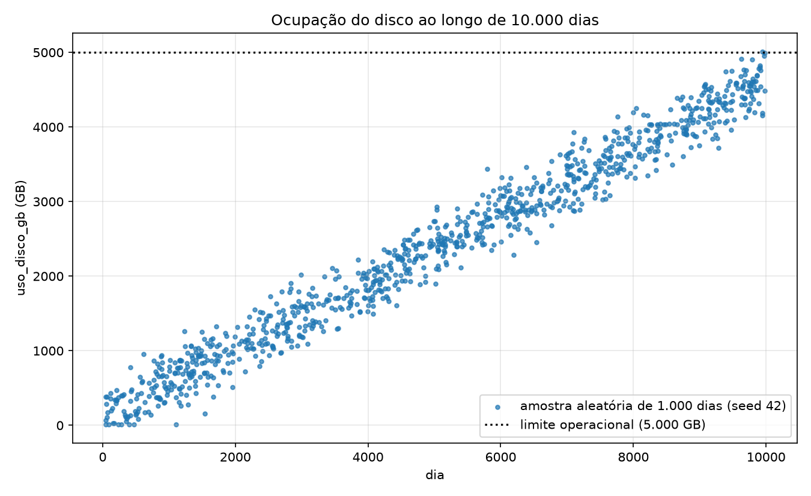
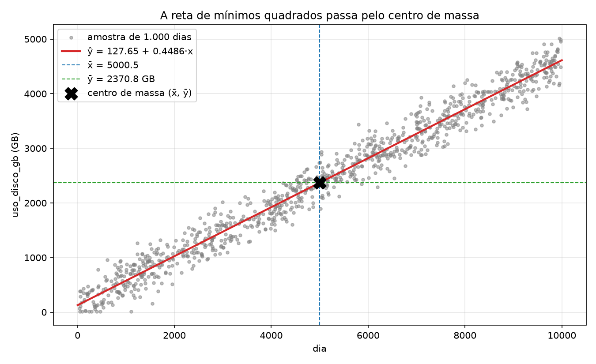
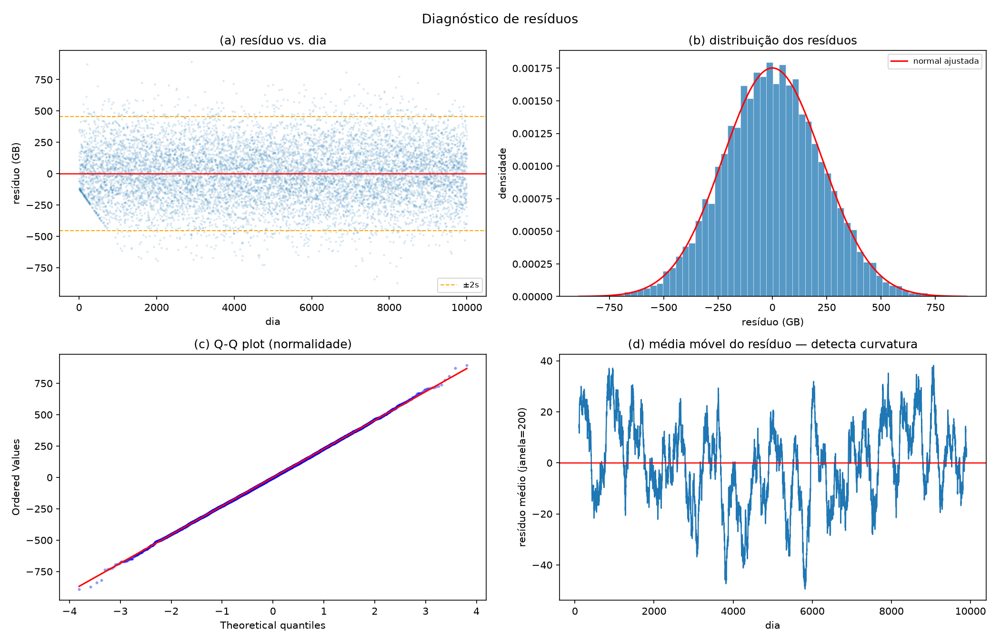
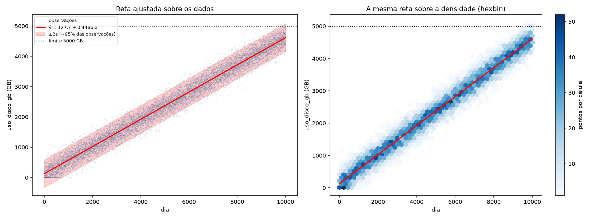
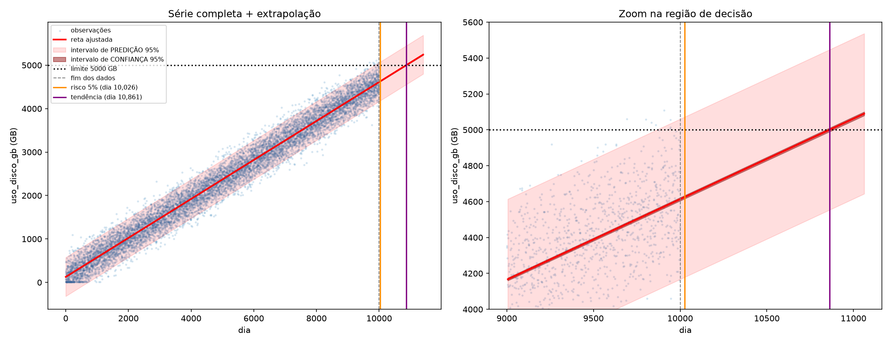

# Regressão Linear Simples — previsão de esgotamento de disco

**Pergunta:** um servidor tem 10.000 dias de medições de ocupação de disco. Quando ele
atinge o limite operacional de 5.000 GB?

**Resposta curta:** a tendência média chega lá em **861 dias**, mas a margem
operacional real é de **26 dias**. A diferença entre as duas respostas é o assunto
deste estudo.

| | Arquivo |
|---|---|
| Enunciado | [`Atividade_Regressao_Linear_Simples.pdf`](Atividade_Regressao_Linear_Simples.pdf) |
| Dados | [`monitoramento_disco_10k_v2.csv`](monitoramento_disco_10k_v2.csv) — `dia` (1 a 10.000) e `uso_disco_gb` |
| Etapa 1 — análise exploratória | [`01_eda.py`](01_eda.py) |
| Etapa 2 — ajuste do modelo | [`02_ajuste.py`](02_ajuste.py) |
| Etapa 3 — avaliação e resíduos | [`03_avaliacao.py`](03_avaliacao.py) |
| Etapa 4 — predição e decisão | [`04_predicao.py`](04_predicao.py) |
| Tudo em um notebook, já executado | [`capacity_planning.ipynb`](capacity_planning.ipynb) |

Cada script roda sozinho, imprime os resultados e salva as figuras em [`figuras/`](figuras/).
A derivação matemática de cada etapa está em comentário no topo do arquivo.

```bash
pip install numpy pandas matplotlib scipy scikit-learn
python 01_eda.py        # e assim por diante, na ordem
```

Testado com Python 3.12, NumPy, pandas, SciPy e scikit-learn 1.9.1 (Ubuntu/WSL).
Se o scikit-learn não estiver disponível, a verificação V5 é pulada e o resto roda
normalmente.

---

## Etapa 1 — Análise exploratória

### Integridade e natureza das variáveis

```python
assert df.shape == (10000, 2)
assert df.isna().sum().sum() == 0
assert np.array_equal(df["dia"].values, np.arange(1, len(df) + 1))
```

`assert condição` não faz nada se a condição for verdadeira e **interrompe o programa**
se for falsa. É uma trava: se o dado não for o que o enunciado promete, nenhuma conta
depois dela vale, então o certo é parar, e não seguir por outro caminho como faria um `if`.
As três linhas conferem:

- `df.shape == (10000, 2)`: 10.000 linhas e 2 colunas;
- `df.isna().sum().sum() == 0`: nenhum valor faltante (`.isna()` marca as células vazias,
  o primeiro `.sum()` conta por coluna, o segundo soma as colunas);
- `np.array_equal(..., np.arange(1, n + 1))`: a coluna `dia` é exatamente 1, 2, …, 10.000,
  sem dia pulado nem repetido.

O dataset passa nas três: 10.000 dias consecutivos, sem lacuna, sem repetição, sem valor
faltante. Os scripts usam `assert` da mesma forma em todos os checkpoints.

As duas colunas são de naturezas diferentes:

- **`dia`**: quantitativa discreta, escala intervalar. Não é uma medição, é o
  **índice** da série. No modelo $y = \beta_0 + \beta_1 x + \varepsilon$ ela é tratada
  como fixa, e toda a aleatoriedade está em $\varepsilon$.
- **`uso_disco_gb`**: quantitativa contínua, escala de razão (0 GB é disco vazio
  de verdade).

Consequência: média e desvio padrão de `dia` não dizem nada sobre o servidor. Para
uma sequência $1, 2, \dots, n$ eles saem só de $n$, e a variância populacional tem
forma fechada:

```math
\mathrm{Var}_{pop}(1..n) = \frac{(n+1)(2n+1)}{6} - \frac{(n+1)^2}{4} = \frac{n^2 - 1}{12}
```

```text
=== Checkpoint 1 — desvio padrão de `dia` ===
fórmula: 2886.895679907168
pandas : 2886.895679907168
```

Bater nas 12 casas confirma que `dia` é exatamente $1..n$. (O pandas usa o estimador
amostral, que divide por $n-1$; a fórmula foi corrigida pelo fator $n/(n-1)$.)

### Estatísticas descritivas de `uso_disco_gb`

| Média | Desvio padrão | Mínimo | Mediana | Máximo |
|---|---|---|---|---|
| 2.370,83 GB | 1.314,90 GB | 10,00 GB | 2.361,63 GB | 5.109,21 GB |

- **Média ≈ mediana** (diferença de 0,4%): distribuição simétrica.
- **O desvio padrão de 1.315 GB não é o ruído diário.** Ele mede a distância típica
  até $\bar y$, uma linha horizontal; como o disco sobe de ~130 para ~4.600 GB ao longo
  da série, quase todo esse desvio é a subida. Medido em torno da reta (Etapa 3), o
  desvio cai para **228 GB**. Mesma fórmula, outra referência.
- **O mínimo e o máximo escondem as duas descobertas da etapa** (abaixo).

### Duas descobertas que o enunciado não antecipa

```python
n_no_piso = (y_serie == 10.0).sum()      # 101
(y_serie > 5000).sum()                   # 9
```

1. **Censura em 10 GB.** 101 dias, entre o dia 14 e o dia 1.102, valem *exatamente*
   10,00 GB. Um valor contínuo não se repete 101 vezes por acaso: é um piso
   artificial. No início da série a tendência ainda é baixa e o ruído levaria a
   ocupação para valores negativos, que não existem, então o gerador cortou em 10 GB.
2. **O limite já foi ultrapassado.** 9 dias da amostra passam de 5.000 GB (o primeiro
   no dia 9.628, o máximo de 5.109 GB no dia 9.908), embora a tendência média ainda
   esteja abaixo. Quem passou foi o ruído, não a reta. Essa é a pista de que a resposta
   "onde a reta cruza 5.000" não vai bastar.

### Gráfico de dispersão

Com 10.000 pontos, o gráfico cru vira uma mancha sólida (*overplotting*). Foram
comparadas quatro representações, cada uma escondendo algo diferente:



| Painel | O que mostra | O que esconde |
|---|---|---|
| (a) cru | nada além da mancha | a densidade |
| (b) transparência | a densidade, como gradiente | os pontos isolados |
| (c) amostra de 1.000 | cada ponto, nítido | a cauda (dos 9 dias acima do limite, ~1 entra) |
| (d) hexbin | a densidade, medida em pontos por célula | os pontos individuais |

Para o relatório foi escolhida a **(c)**, com a linha do limite: o objetivo é ver a
tendência e quanto ela se aproxima dos 5.000 GB. O que ela esconde (a cauda) fica
registrado no texto acima.



**Comportamento observado:** tendência **linear** (sobe como uma faixa reta, sem
acelerar nem achatar), com **ruído grande** (faixa de uns ±450 GB) e de **espessura
constante** do início ao fim. Essa última é uma suspeita visual que a Etapa 3 confirma
em número.

---

## Etapa 2 — Ajuste do modelo

### Mínimos quadrados

Minimizando o erro acumulado $E(\beta_0, \beta_1) = \sum (y_i - \beta_0 - \beta_1 x_i)^2$,
as derivadas parciais iguais a zero dão as **equações normais**, cuja solução é:

```math
\hat\beta_1 = \frac{S_{xy}}{S_{xx}} = \frac{\sum (x_i - \bar x)(y_i - \bar y)}{\sum (x_i - \bar x)^2}
\qquad
\hat\beta_0 = \bar y - \hat\beta_1 \bar x
```

```python
def calcular_sxx(x):
    desvios = x - np.mean(x)
    return np.dot(desvios, desvios)

def calcular_sxy(x, y):
    return np.dot(x - np.mean(x), y - np.mean(y))

def ajustar(x, y):
    b1 = calcular_sxy(x, y) / calcular_sxx(x)
    b0 = np.mean(y) - b1 * np.mean(x)
    return b0, b1
```

**Lendo a fórmula:** $S_{xy}$ é a covariância não normalizada. Cada termo é um produto
de dois desvios, positivo quando $x$ e $y$ estão do mesmo lado das suas médias. Então
$\hat\beta_1 = S_{xy}/S_{xx}$ é "quanto $y$ anda junto com $x$" dividido por "quanto
$x$ varia sozinho": quanto $y$ muda, em média, por unidade de $x$.

O **chapéu** marca *estimativa*: $\beta_1$ é a inclinação verdadeira do processo, que
ninguém conhece; $\hat\beta_1$ é o que esta amostra permite estimar. E $\hat y$ é o
valor previsto pelo modelo, em oposição ao $y$ observado.

```math
\boxed{\hat y = 127{,}65 + 0{,}448590 \cdot x}
```

### Verificações

Nenhuma verificação compara com um "valor esperado"; cada uma confere o resultado
contra uma forma matematicamente equivalente.

```text
  [OK]    V1  Sxx bate com a forma fechada n(n²−1)/12
  [OK]    V2  Sxy bate com a forma expandida Σxy − n·x̄·ȳ
  [OK]    V3  a reta passa pelo centro de massa (β₀ + β₁·x̄ = ȳ)
  [OK]    V4  equações normais: Σeᵢ ≈ 0  e  Σxᵢeᵢ ≈ 0
  [OK]    V5  coincide com sklearn.LinearRegression
  [OK]    V6  β₁ na mesma ordem de grandeza da reta de dois pontos
  [OK]    V7  forma matricial (CᵀCβ = Cᵀy) == fórmulas Sxy/Sxx
  [OK]    V8  4 pontos da folha → β₁ = 1,97188755 e β₂ = 1,807228916
```

A V6 é um teste de ordem de grandeza feito *antes* do ajuste: a reta que liga a média
dos primeiros 500 dias à dos últimos 500 tem inclinação 0,4474 GB/dia, contra 0,4486
do ajuste (razão 1,003).

### A reta passa pelo centro de massa

$\hat\beta_0 = \bar y - \hat\beta_1 \bar x$ implica $\hat\beta_0 + \hat\beta_1 \bar x = \bar y$:
a reta de mínimos quadrados passa obrigatoriamente pelo ponto $(\bar x, \bar y)$.



O motivo é a equação normal $\sum e_i = 0$: os resíduos acima e abaixo da reta se
cancelam, e a reta fica equilibrada no meio da nuvem, como uma régua apoiada no ponto
de equilíbrio.

### Interpretação dos coeficientes

```text
I1  β₁ = 0.448590 GB/dia ≈ 13.46 GB/mês ≈ 163.7 GB/ano
I2  β₀ = 127.65 GB (ocupação prevista no dia 0)
I3  dia 1: previsto 128.10 GB × observado 233.93 GB → resíduo e₁ = +105.83 GB
I4  sem os dias ≤ 1102: β₀ = 121.25 GB (-6.40),  β₁ = 0.449522 (+0.21%)
```

- **$\hat\beta_1$**: o servidor consome em média **13,5 GB por mês** (~164 GB por ano).
- **$\hat\beta_0$**: ocupação de base quando o monitoramento começou. A leitura física
  vale porque o dia 0 está a um dia do início dos dados; seria só um ponto de corte
  sem significado se estivesse longe da faixa observada.
- **Previsto × observado no dia 1** não batem, e não deveriam: a reta é a média
  esperada; a diferença de +105,8 GB é o ruído daquele dia, o resíduo $e_1$.
- **Efeito da censura:** o piso artificial só levanta valores, e está todo no início
  da série, onde o intercepto é determinado. Então empurra $\hat\beta_0$ para cima.
  Reajustando sem a região censurada, $\hat\beta_0$ cai 6,4 GB e $\hat\beta_1$ muda
  só 0,21%. O efeito existe, na direção prevista, e é pequeno: o modelo completo é
  mantido, com a ressalva declarada.

---

## O mesmo ajuste na forma matricial

Em aula, o orientador demonstrou o método dos mínimos quadrados na forma matricial,
com um exemplo de 4 pontos. O mesmo método aplicado aos 10.000 dias é o segundo
caminho da Etapa 2.

As $n$ equações $\beta_1 x_i + \beta_2 = y_i$ viram um sistema $C\beta = y$:

```math
\underbrace{\begin{bmatrix} x_1 & 1 \\ x_2 & 1 \\ \vdots & \vdots \\ x_n & 1 \end{bmatrix}}_{C_{n\times 2}}
\underbrace{\begin{bmatrix} \beta_1 \\ \beta_2 \end{bmatrix}}_{\beta}
=
\underbrace{\begin{bmatrix} y_1 \\ \vdots \\ y_n \end{bmatrix}}_{y}
```

São 10.000 equações e 2 incógnitas, sem solução exata. Multiplicando os dois lados por
$C^T$:

```math
\underbrace{C^T C}_{A}\,\beta = \underbrace{C^T y}_{b}
\qquad
A = \begin{bmatrix} \sum x_i^2 & \sum x_i \\ \sum x_i & n \end{bmatrix}
\qquad
b = \begin{bmatrix} \sum x_i y_i \\ \sum y_i \end{bmatrix}
```

```python
def ajustar_matricial(x, y):
    C = np.column_stack([x, np.ones(len(x))])
    A = C.T @ C
    b = C.T @ y
    beta1, beta2 = np.linalg.solve(A, b)     # ordem da folha: [inclinação, intercepto]
    return beta2, beta1
```

```text
Fórmulas Sxy/Sxx : ŷ = 127.65328660 + 0.4485898939·x
Forma matricial  : ŷ = 127.65328660 + 0.4485898939·x
```

**Por que dão o mesmo resultado:** $A\beta = b$ são literalmente as equações normais.
O gradiente de $E(\beta) = \lVert y - C\beta \rVert^2$ é $-2\,C^T(y - C\beta)$; igualar
a zero dá $C^TC\beta = C^Ty$. Mesma matemática, outra escrita.

**O que a forma matricial ganha:** $A$ é 2×2 com 4 pontos ou com 10.000, porque o tamanho
da base só entra nos somatórios. E, com mais variáveis de entrada, basta acrescentar
colunas em $C$; as fórmulas $S_{xy}/S_{xx}$ só existem para uma variável.

**O que ela custa:** com os 4 pontos do exemplo de aula, o número de condição de $A$ é
~72; com os 10.000 dias, ~1,3·10⁸, porque $\sum x^2 \approx 3{,}3\cdot10^{11}$ convive
com $n = 10^4$ na mesma matriz. Em precisão dupla o resultado ainda sai exato (V7), mas
é por isso que bibliotecas como `np.linalg.lstsq` resolvem $C\beta \approx y$ direto,
sem montar $C^TC$.

---

## Etapa 3 — Avaliação e resíduos

### Decomposição da variância

```math
\underbrace{\sum (y_i - \bar y)^2}_{SQT}
= \underbrace{\sum (\hat y_i - \bar y)^2}_{SQR}
+ \underbrace{\sum (y_i - \hat y_i)^2}_{SQE}
```

A identidade só vale porque o termo cruzado $2\sum(\hat y_i - \bar y)\,e_i$ é zero, e
ele é zero por causa das equações normais da Etapa 2. Ou seja: o $R^2$ só tem essa
leitura porque o ajuste foi por mínimos quadrados.

```text
SQT = 17,288,003,210
SQR = 16,769,407,574
SQE = 518,595,636

R²   = 0.970003
RMSE = 227.73 GB
s    = 227.75 GB   (divisor n−2)
MAE  = 181.55 GB

CHECKPOINT 6 OK — r = 0.984887,  r² = 0.970003 = R²
```

$s = \sqrt{SQE/(n-2)}$ divide por $n-2$ porque dois graus de liberdade foram gastos
estimando $\hat\beta_0$ e $\hat\beta_1$. Com $n = 10.000$ a diferença para o RMSE é
invisível, mas é o $s$ que a Etapa 4 usa.

### R² alto e erro grande ao mesmo tempo

| | Modelo trivial ($\hat y = \bar y$) | Regressão linear |
|---|---|---|
| R² | 0 | 0,970 |
| RMSE | 1.315 GB | 228 GB |
| MAE | 1.133 GB | 182 GB |

Não há contradição. O $R^2$ é uma razão sem unidade: compara o erro do modelo com o de
um modelo que chuta sempre a média. Como o disco sobe ~4.500 GB ao longo da série, a
variação total é enorme, e a reta captura 97% dela. Os 3% que sobram de uma variação
enorme ainda são ±228 GB.

$1 - R^2$ **não** é "a chance de o modelo errar" nem "margem de erro de 3%": é fração da
variância. A tradução operacional é o RMSE: *uma leitura diária se afasta da tendência
em tipicamente ± 228 GB*.

### Diagnóstico de resíduos



- **(a) Resíduo × dia:** faixa de largura constante em torno de zero, ou seja,
  **homocedasticidade**. Em número, o desvio dos resíduos por terço da série é
  222 / 230 / 231 GB. A reta descendente no canto inferior esquerdo é a censura da
  Etapa 1: para os dias travados em 10 GB, $e = 10 - \hat y$, que é uma reta de
  inclinação $-\hat\beta_1$.
- **(b) e (c) Normalidade:** distribuição simétrica (assimetria 0,02) e colada na normal
  (curtose em excesso 0,03); no Q-Q plot os pontos seguem a diagonal inteira.
- **(d) Média móvel:** oscila em torno de zero sem tendência, então **não há
  curvatura**: a relação é de fato uma reta.

As hipóteses do modelo se sustentam, e isso dá à Etapa 4 o direito de usar $s$ e a
distribuição normal para falar de risco.



### Linear × polinomial

| Grau | Parâmetros | R² | R² ajustado | RMSE (GB) |
|---|---|---|---|---|
| 1 | 2 | 0,970003 | 0,97000 | 227,73 |
| 2 | 3 | 0,970026 | 0,97002 | 227,64 |
| 3 | 4 | 0,970029 | 0,97002 | 227,63 |

Passar para grau 2 melhora o $R^2$ ajustado em 0,00002, ou seja, nada. O modelo linear é
o adequado (parcimônia), o que bate com a média móvel sem curvatura.

### Autocorrelação dos resíduos

Séries temporais costumam ter dias correlacionados: um dia acima da reta tende a vir
seguido de outro acima. Se fosse o caso, os 10.000 dias valeriam menos que 10.000
informações independentes, e os intervalos da Etapa 4 sairiam otimistas.

```math
DW = \frac{\sum (e_i - e_{i-1})^2}{\sum e_i^2} \approx 2(1 - \rho_1)
```

```text
Durbin-Watson                 = 2.027   (2 = nenhuma autocorrelação)
correlação entre dias vizinhos = -0.0137
desvio da média móvel: observado 16.09 GB × esperado se independentes 16.10 GB
```

**Não há autocorrelação.** As ondas de até ±45 GB do painel (d) parecem padrão no olho,
mas a média móvel oscila exatamente o que ruído independente oscilaria. Só o número
separou "parece" de "é".

---

## Etapa 4 — Predição e decisão

### A resposta que o enunciado pede

```math
\hat\beta_0 + \hat\beta_1 x^* = 5000 \quad\Longrightarrow\quad x^* = \frac{5000 - \hat\beta_0}{\hat\beta_1}
```

```text
Dia em que a TENDÊNCIA atinge 5000 GB:  x* = 10,861.5
Dias restantes (resposta direta):             861 dias (≈ 28.7 meses)
```

### Por que essa resposta não basta

$x^*$ é o dia em que a **média** prevista cruza 5.000 GB. O disco não enche na média:
enche num dia concreto, com o ruído daquele dia. São dois intervalos diferentes, e a
diferença é um "1" dentro da raiz:

```math
\text{confiança (a média):}\quad \hat y_0 \pm t\,s\sqrt{\frac{1}{n} + \frac{(x_0 - \bar x)^2}{S_{xx}}}
\qquad
\text{predição (um dia):}\quad \hat y_0 \pm t\,s\sqrt{1 + \frac{1}{n} + \frac{(x_0 - \bar x)^2}{S_{xx}}}
```

```text
Em x₀ = x* = 10,861:
  1                 = 1.000000
  1/n               = 0.000100
  (x₀ − x̄)²/Sxx     = 0.000412
→ a variabilidade do dia é 99.9% do total sob a raiz

Em x*:  IC 95% da média = ±10.10 GB
        IP 95% de um dia = ±446.55 GB   (44× mais largo)
```

Sabemos muito bem onde a média estará (±10 GB); não sabemos onde um dia específico
estará (±447 GB). E é um dia específico que estoura o disco.

### O dia em que o risco se torna real

O critério de capacity planning é o percentil, não a média: procura-se o dia em que há
5% de chance de uma leitura passar do limite.

```math
\hat\beta_0 + \hat\beta_1 x + z_{0,95}\, s = 5000 \qquad (z_{0,95} \approx 1{,}645)
```

```text
Dia em que a TENDÊNCIA atinge 5000 GB     : 10,861
Dia em que o PERCENTIL 95 atinge 5000 GB  : 10,026

P(estouro) no último dia observado         : 4.49%
Margem real a partir do dia 10000          : 26 dias

Validação (dias 9.501–10.000):
  taxa observada de estouro : 1.80%
  taxa prevista pelo modelo : 1.76%
```

A validação é o que dá confiança ao número: nos últimos 500 dias, o modelo previu 1,76%
de dias acima do limite, e a amostra teve 1,80%. O modelo acerta não só a média, mas a
**cauda**, que é exatamente o que a decisão usa.



No zoom, a banda escura (confiança) é uma linha fina em torno da reta; a banda clara
(predição) é que encosta no limite, já no dia 10.026.

### Recomendação técnica

| | Dia | Margem a partir do fim dos dados |
|---|---|---|
| A **tendência** atinge 5.000 GB | 10.861 | 861 dias |
| O **percentil 95** atinge 5.000 GB | 10.026 | **26 dias** |

1. A resposta direta (861 dias) descreve a ocupação média e superestima a margem em mais
   de 30 vezes. A margem operacional real é de **~26 dias**, e 9 dias da amostra já
   estouraram o limite.
2. Tratar como capacidade crítica **agora**: o prazo de compra e provisionamento de
   hardware provavelmente já é maior que a margem.
3. Há duas alavancas, matematicamente diferentes:
   - **mudar o teto** (disco maior, migração): sobe a linha dos 5.000 GB, e a reta
     continua igual;
   - **mudar a inclinação** (retenção e expurgo de logs): reduz os 13,5 GB/mês, e todas
     as datas andam para a frente.

   A primeira compra tempo uma vez; a segunda, continuamente.
4. **Hipótese declarada:** a projeção assume que a tendência linear continua depois do
   dia 10.000. O modelo não sabe de migrações, expurgos ou de um deploy que dobre o
   volume; deve ser reavaliado com os dados novos.
