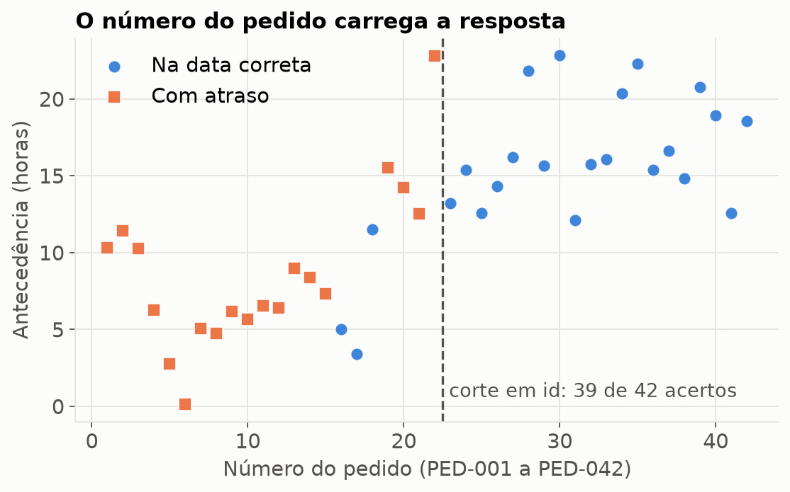
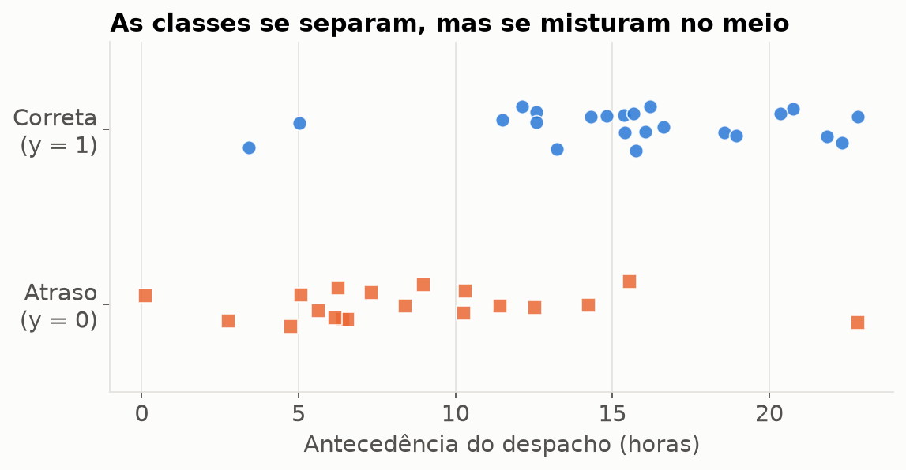
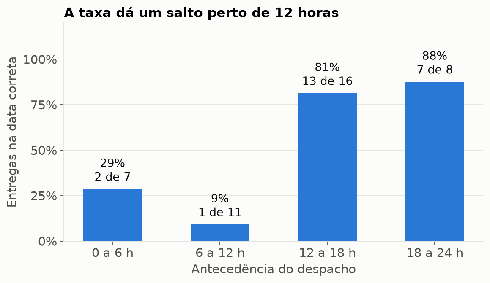
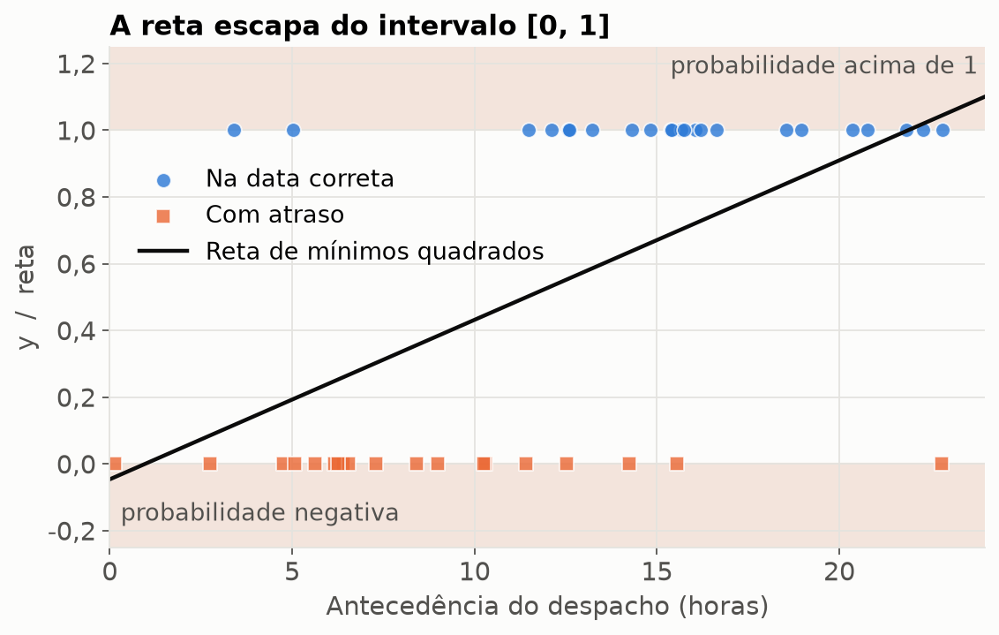
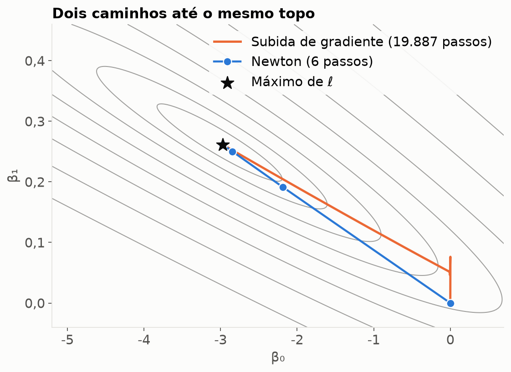
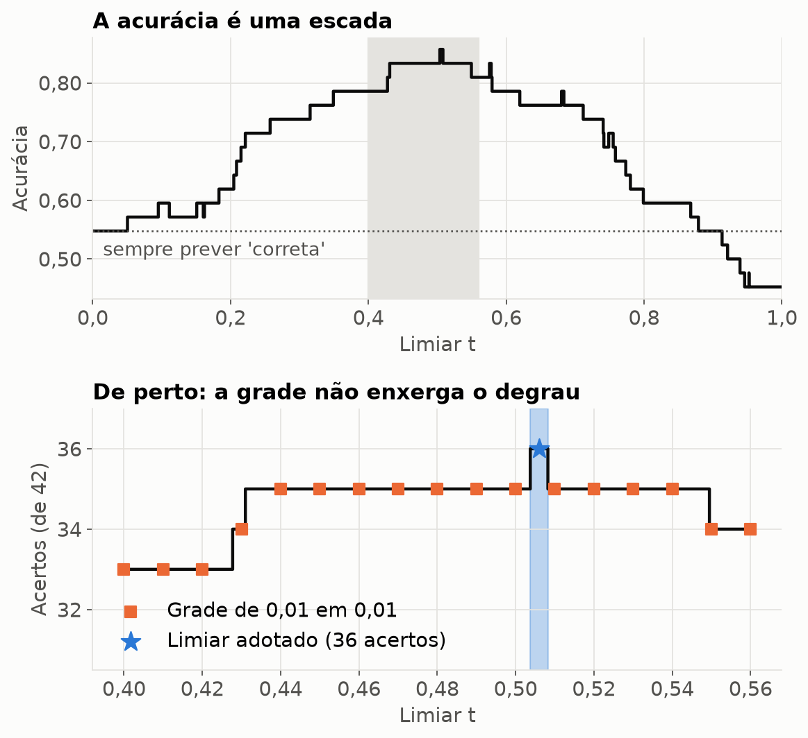
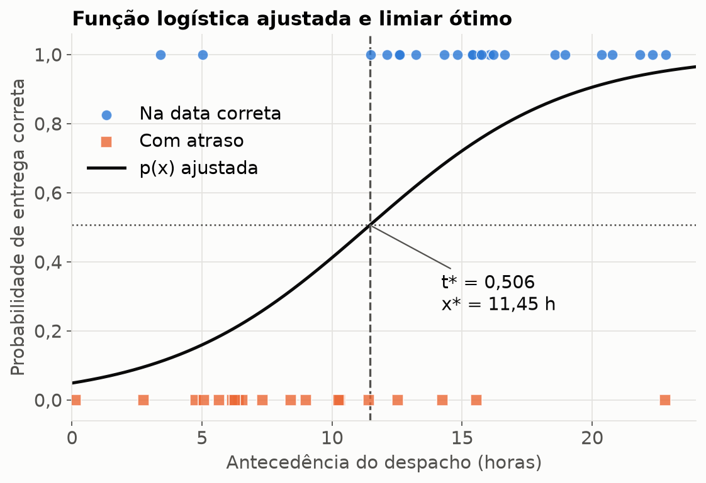
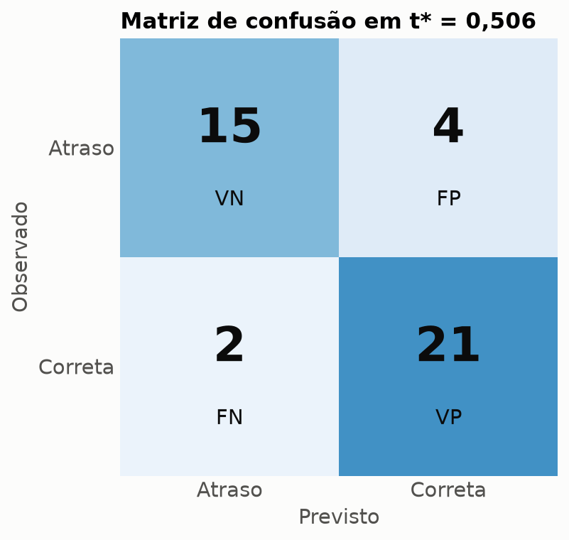
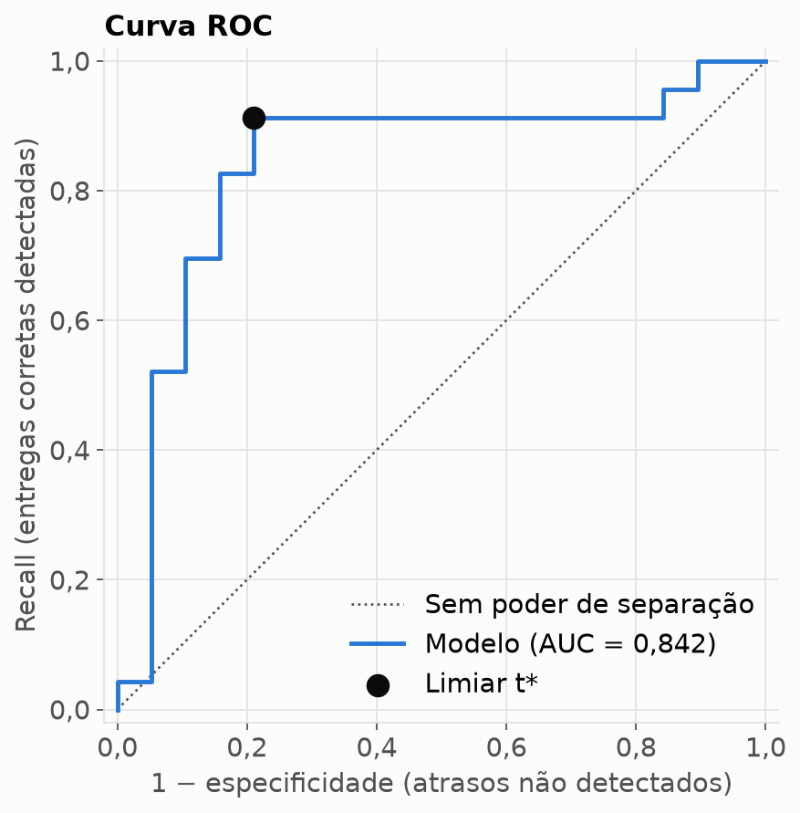

# Regressão Logística Simples — previsão de entrega no prazo

**Pergunta:** a antecedência com que um pedido é despachado ajuda a prever se ele chega na
data correta?

**Resposta curta:** ajuda. Cada hora a mais multiplica a chance de entrega correta por
**1,30**, e a melhor regra separa os pedidos em **11,45 horas** de antecedência, acertando
**36 de 42** (85,7%). Fora da amostra, a estimativa honesta cai para **34 de 42** (81%).

| | Arquivo |
|---|---|
| Enunciado | [`Atividade_Regressao_Logistica_Simples.pdf`](Atividade_Regressao_Logistica_Simples.pdf) |
| Dados | [`dados_logistica.csv`](dados_logistica.csv) — `Pedido`, `Antecedência x [h]` e `Resultado y` |
| Itens 1 a 4 — problema, tarefa, variáveis e visualização | [`01_eda.py`](01_eda.py) |
| Item 5 — ajuste do modelo | [`02_ajuste.py`](02_ajuste.py) |
| Itens 6 e 7 — limiar, curva e matriz de confusão | [`03_classificacao.py`](03_classificacao.py) |
| Item 8 — métricas | [`04_metricas.py`](04_metricas.py) |
| Leitura dos dados e estilo das figuras | [`comum.py`](comum.py) |
| Tudo em um notebook, já executado | [`previsao_entregas.ipynb`](previsao_entregas.ipynb) |

Cada script roda sozinho, imprime os resultados e salva as figuras em [`figuras/`](figuras/).
A derivação matemática de cada etapa está em comentário no topo do arquivo.

```bash
pip install numpy pandas matplotlib scipy scikit-learn
python 01_eda.py        # e assim por diante, na ordem
```

Testado com Python 3.12, NumPy, pandas, SciPy e scikit-learn 1.9.1 (Ubuntu/WSL).
Se o scikit-learn não estiver disponível, a verificação V7 e as conferências contra
`sklearn.metrics` são puladas e o resto roda normalmente.

---

## Itens 1 e 2 — O problema e o tipo de tarefa

Uma transportadora quer saber se despachar com mais antecedência aumenta a chance de cumprir
o prazo. A antecedência $x$ é o número de horas entre o despacho e o prazo final, e o
resultado é $y = 1$ para entrega na data correta e $y = 0$ para atraso.

A tarefa é de **aprendizado supervisionado** (cada pedido vem com o resultado observado) e de
**classificação binária** (a saída é uma de duas categorias). O nome "regressão" vem de o
modelo prever um número, a probabilidade. A classificação só acontece depois, quando um limiar
corta essa probabilidade.

Como $y$ só vale 0 ou 1, ele é uma variável de Bernoulli, cuja média é a própria probabilidade
de sucesso:

```math
E[Y \mid x] = 1 \cdot P(Y=1 \mid x) + 0 \cdot P(Y=0 \mid x) = p(x)
```

Modelar a média de $y$, que é o que toda regressão faz, aqui é modelar uma probabilidade.

---

## Item 3 — Variáveis e dados

```python
assert df.shape == (42, 4)                  # 3 colunas do CSV + id
assert df.isna().sum().sum() == 0           # nenhum valor faltante
assert df["pedido"].is_unique               # nenhum pedido repetido
assert set(df["id"]) == set(range(1, 43))   # PED-001 a PED-042, sem buraco
assert set(df["y"]) == {0, 1}               # alvo realmente binário
```

O arquivo passa em todas as travas. Ele começa com BOM (uma marca invisível gravada pelo Excel),
por isso é lido com `encoding="utf-8-sig"`.

- **`Pedido`**: identificador. Não é variável do modelo.
- **`Antecedência x [h]`**: quantitativa contínua, escala de razão (0 h é despachar em cima do
  prazo). É a variável explicativa.
- **`Resultado y`**: qualitativa binária. É o alvo.

| Classe | Pedidos | Média de $x$ | Desvio | Mínimo | Mediana | Máximo |
|---|---|---|---|---|---|---|
| $y = 1$ (data correta) | 23 (54,8%) | 15,49 h | 4,87 h | 3,41 h | 15,67 h | 22,83 h |
| $y = 0$ (atraso) | 19 (45,2%) | 8,71 h | 5,14 h | 0,13 h | 7,31 h | 22,81 h |

- **As classes estão quase equilibradas**, então a acurácia não fica inflada por uma classe
  dominante. A referência é 54,8%: o acerto de quem sempre prevê "data correta".
- **As médias diferem em quase 7 horas**, o que já sugere relação.
- **As classes se misturam** entre 3,41 h e 22,81 h. Isso é uma boa notícia para o ajuste: se
  um corte separasse tudo perfeitamente, $\hat\beta_1$ iria para infinito e o ótimo não existiria.

### Uma descoberta que o enunciado não antecipa

O número do pedido deveria ser neutro, mas não é:

```text
y na ordem do pedido: 000000000000000111000011111111111111111111
tamanho dos blocos  : [15, 3, 4, 20]

melhor corte em id: id ≥ 22.5 acerta 39/42
melhor corte em x : x ≥ 11.455 acerta 36/42
```



**O número do pedido acerta mais que a antecedência.** Isso é um *vazamento*: uma coluna que
carrega a resposta sem explicar nada. Um modelo que a usasse pareceria melhor e não serviria
para nada num pedido novo, por isso ela fica de fora.

A explicação provável (hipótese, não há como provar pelo arquivo) é que a tabela foi montada em
blocos e depois embaralhada. Os quatro blocos lembram os quadrantes de uma matriz de confusão:
15 atrasos com pouca antecedência, 3 acertos com pouca antecedência, 4 atrasos com muita e 20
acertos com muita.

---

## Item 4 — Visualização antes do ajuste



As entregas corretas se concentram à direita e os atrasos à esquerda, com pedidos dos dois
tipos fora do lugar. Dois chamam atenção: uma entrega correta com 3,41 h e um atraso com 22,81 h.

Agrupar por faixa dá uma primeira estimativa de $p(x)$, sem modelo nenhum:



A subida não é gradual: a taxa fica baixa até 12 h e salta para 81%. A faixa de 0 a 6 h ainda
fica acima da de 6 a 12 h, por conta de 2 pedidos em 7. O efeito disso aparece na calibração,
no item 8.

### Por que a reta não serve

```text
ŷ = -0.0462 + 0.0478·x
em x = 0  → -0.046   (probabilidade negativa)
em x = 24 → 1.101    (probabilidade acima de 1)
```



Há dois problemas. A reta é ilimitada, então sai de $[0, 1]$. E a variância de uma Bernoulli é
$p(1-p)$, que muda com $x$, o que derruba a hipótese de variância constante da regressão linear.

---

## Item 5 — Ajuste da regressão logística

### De onde vem a sigmoide

Precisamos de uma quantidade que vá de $-\infty$ a $+\infty$ para igualar a uma reta. O caminho é
transformar a probabilidade em **chance** e depois em **log da chance**:

```math
p \in (0, 1)
\quad\longrightarrow\quad
\frac{p}{1-p} \in (0, \infty)
\quad\longrightarrow\quad
\ln\frac{p}{1-p} \in (-\infty, \infty)
```

Igualando o log da chance à reta $Z(x) = \beta_0 + \beta_1 x$ e isolando $p$, sai a função do
enunciado:

```math
\ln\frac{p}{1-p} = Z
\quad\Longrightarrow\quad
p = \frac{e^{Z}}{1 + e^{Z}} = \frac{1}{1 + e^{-Z}}
```

A reta continua lá dentro: é o $Z$. A sigmoide só a dobra para caber em $(0, 1)$.

### a) Otimização

Cada pedido é uma Bernoulli. A probabilidade do que foi observado é $p_i$ se $y_i = 1$ e
$1 - p_i$ se $y_i = 0$. Com pedidos independentes, a probabilidade da amostra é o produto, e o
logaritmo troca o produto por uma soma sem mudar onde está o máximo. Essa é a
**log-verossimilhança**:

```math
\ell(\beta) = \sum_{i=1}^{n} \big[\, y_i \ln p_i + (1 - y_i)\ln(1 - p_i) \,\big]
```

Otimizar é achar o $\beta$ que torna o que aconteceu o mais provável possível. Como a sigmoide
tem derivada $dp/dZ = p(1-p)$, os termos se cancelam e sobra, com $C = [\,1 \;\; x\,]$:

```math
\nabla \ell = C^T (y - p)
\qquad\qquad
H = -\,C^T W C, \quad W = \mathrm{diag}\big(p_i(1 - p_i)\big)
```

O gradiente tem a mesma estrutura da regressão linear, "resíduo vezes entrada". A diferença é
que $p = \sigma(C\beta)$ não é linear em $\beta$, então $\nabla\ell = 0$ não vira um sistema
linear: **não existe fórmula fechada**. Por outro lado, $H$ é negativa definida, logo $\ell$ é
côncava e tem um único topo.

Foram implementados dois métodos:

```math
\underbrace{\beta \leftarrow \beta + \alpha\, C^T(y - p)}_{\text{subida de gradiente}}
\qquad\qquad
\underbrace{\beta \leftarrow \beta + (C^T W C)^{-1} C^T (y - p)}_{\text{Newton-Raphson}}
```

```python
def gradiente(beta, C, y):
    return C.T @ (y - sigmoide(C @ beta))

def hessiana(beta, C):
    p = sigmoide(C @ beta)
    pesos = p * (1 - p)
    return -(C.T * pesos) @ C

def ajustar_newton(x, y, tol=1e-10, max_iter=100):
    C = matriz_c(x)
    beta = np.zeros(2)
    trajetoria = [beta.copy()]
    for _ in range(max_iter):
        passo = np.linalg.solve(-hessiana(beta, C), gradiente(beta, C, y))
        beta = beta + passo
        trajetoria.append(beta.copy())
        if np.max(np.abs(passo)) < tol:
            break
    return beta, np.array(trajetoria)
```

```text
iter           β₀           β₁         ℓ(β)
   0   0.00000000   0.00000000   -29.112182
   1  -2.18492951   0.19119052   -21.511944
   2  -2.84541601   0.25023898   -21.099167
   3  -2.96648319   0.26104509   -21.089636
   4  -2.97004225   0.26136028   -21.089628
   5  -2.97004519   0.26136054   -21.089628
   6  -2.97004519   0.26136054   -21.089628

Newton             : 6 iterações
Subida de gradiente: 19,887 iterações
```



Os dois chegam ao mesmo ponto. A subida de gradiente só conhece a inclinação e precisa de um
passo pequeno, porque $x^2$ dentro de $C^TC$ deixa a superfície muito mais íngreme numa direção
que na outra. Newton usa também a curvatura e por isso precisa de 6 passos, não de quase 20 mil.

### A ponte com a forma matricial vista em aula

Cada passo de Newton resolve $(C^TWC)\,\Delta = C^T(y - p)$, que é o sistema $C^TC\beta = C^Ty$
da demonstração de mínimos quadrados, agora com pesos. Por isso o método também é chamado de
IRLS (mínimos quadrados reponderados iterativamente).

Saindo de $\beta = 0$, todos os $p_i$ valem $1/2$ e todos os pesos valem $1/4$, e o primeiro passo
fica:

```math
\beta^{(1)} = 4\,(C^TC)^{-1}C^T\Big(y - \tfrac{1}{2}\Big)
```

Ou seja, **quatro vezes a reta de mínimos quadrados** ajustada em $y - 1/2$. A regressão logística
começa, literalmente, na regressão linear. (Aqui a ordem das colunas é $[\,1 \;\; x\,]$, para seguir
$\beta_0, \beta_1$ do enunciado; na folha da regressão linear era $[\,x \;\; 1\,]$.)

### Verificações

Nenhuma verificação compara com um "valor esperado"; cada uma confere uma identidade.

```text
  [OK]    V1  σ(0) = 1/2  e  σ(−z) = 1 − σ(z)
  [OK]    V2  gradiente analítico = derivada numérica de ℓ
  [OK]    V3  hessiana analítica = derivada numérica do gradiente
  [OK]    V4  equações de escore no ótimo: Σ(y − p) ≈ 0  e  Σx(y − p) ≈ 0
  [OK]    V5  hessiana negativa definida (ℓ é côncava: o topo é único)
  [OK]    V6  subida de gradiente chega ao mesmo β de Newton
  [OK]    V7  coincide com sklearn LogisticRegression(C=np.inf)
  [OK]    V8  1º passo de Newton = 4 × reta de mínimos quadrados em y − 1/2
```

A V4 é o equivalente de $\sum e_i = 0$ na regressão linear e tem uma consequência concreta:
$\sum p_i = \sum y_i$. O modelo prevê exatamente as 23 entregas corretas no total.

**Cuidado com o padrão do sklearn.** `LogisticRegression()` aplica regularização L2 (`C=1`) sem
avisar, e por isso não devolve a máxima verossimilhança que o enunciado pede:

| | $\hat\beta_0$ | $\hat\beta_1$ |
|---|---|---|
| Implementação própria | −2,970045 | 0,261361 |
| sklearn com `C=np.inf` | −2,970045 | 0,261361 |
| sklearn padrão (`C=1`) | −2,949310 | 0,259623 |

O `C` é o inverso da força da penalidade, então `C=np.inf` a desliga. A forma antiga,
`penalty=None`, está deprecada desde a versão 1.8 e sai na 1.10.

### b) Coeficientes e funções

```math
\boxed{Z(x) = -2{,}9700 + 0{,}2614\,x}
\qquad
\boxed{p(x) = \frac{1}{1 + e^{-(-2{,}9700 \,+\, 0{,}2614\,x)}}}
```

### c) Interpretação do sinal de $\beta_1$

$\hat\beta_1 = 0{,}2614 > 0$: a probabilidade de entrega na data correta **aumenta** com a
antecedência.

O valor tem uma leitura exata na escala da chance. Como $\ln(\text{chance}) = Z$, somar 1 hora
soma $\beta_1$ ao log da chance, ou seja, multiplica a chance por $e^{\beta_1}$:

```text
razão de chances  : e^β₁ = 1.2987 → cada hora multiplica a chance por 1.30
IC 95% da razão   : [1.105, 1.526]
10 horas a mais   : chance × 13.6
p(x) = 0,5 em     : x = −β₀/β₁ = 11.364 h
inclinação máxima : β₁/4 = 0.0653 por hora (em x = 11.36 h)
```

- **O efeito é constante na chance, não na probabilidade.** Cada hora multiplica a chance por
  1,30 em qualquer ponto da curva. Já a probabilidade sobe no máximo 6,5 pontos percentuais
  por hora, e isso só perto de 11,4 h; nas pontas sobe bem menos.
- **$\hat\beta_0 = -2{,}97$** é o log da chance em $x = 0$: $p(0) = 4{,}9\%$ para quem despacha em
  cima do prazo. A leitura vale porque $x = 0$ está colado à faixa observada, que começa em 0,13 h.
- **O efeito é real, mas a estimativa é larga.** O erro padrão de $\hat\beta_1$ é 0,0823, com
  IC 95% de [0,100; 0,423]. A razão de verossimilhança compara com o modelo sem $x$:
  $D = 2(\ell_{modelo} - \ell_{nulo}) = 15{,}66$, com $p = 7{,}6 \cdot 10^{-5}$. A antecedência
  ajuda, e isso não é acaso; o tamanho exato do efeito é que está mal determinado com 42 pedidos.

**Sensibilidade:** um único pedido pesa muito. Sem o PED-022 (atraso com 22,81 h, para o qual o
modelo dava $p = 0{,}952$), $\hat\beta_1$ sobe de 0,261 para 0,354, **35% a mais**.

### d) e e) Probabilidades para 5, 10, 15 e 20 horas

| Antecedência | $Z(x)$ | Chance | $P(Y=1 \mid x)$ | $P(Y=0 \mid x)$ |
|---|---|---|---|---|
| 5 h | −1,6632 | 0,190 | **15,93%** | 84,07% |
| 10 h | −0,3564 | 0,700 | **41,18%** | 58,82% |
| 15 h | 0,9504 | 2,587 | **72,12%** | 27,88% |
| 20 h | 2,2572 | 9,556 | **90,53%** | 9,47% |

Cada 5 horas multiplicam a chance por $e^{5\beta_1} = 3{,}7$: é só conferir a coluna "Chance". A
probabilidade não segue esse ritmo: sobe 25, 31 e 18 pontos percentuais, mais rápido no meio.

---

## Item 6 — Classificação, limiar e curva logística

A regra é $\hat y = 1$ se $p(x) \ge t$. Falta escolher $t$, e o enunciado pede o que maximiza a
acurácia.

### A acurácia é uma escada

Ela é uma contagem de acertos, então só muda quando $t$ cruza a probabilidade de algum pedido.
Isso tem três consequências:

1. **Não adianta derivar.** A função é constante por trechos: aqui não se otimiza, se enumera.
2. **Existem no máximo $n + 1$ classificações diferentes.** Testar cada $p_i$ como limiar cobre
   todas. Foram 43 candidatos.
3. **O máximo é uma faixa, não um número.** Qualquer $t$ dentro dela classifica igual.

```text
acertos em t = 0,5 : 35/42
melhor resultado   : 36/42 = 0.8571
degrau ótimo       : t ∈ (0.5037, 0.5082]   largura 0.0046
```



**O degrau ótimo é mais estreito que uma grade comum.** Testando limiares de 0,01 em 0,01, o
valor 0,50 fica logo abaixo e 0,51 logo acima, e a busca para em 35 acertos:

```text
passo 0.1   : melhor 35/42
passo 0.05  : melhor 35/42
passo 0.01  : melhor 35/42
passo 0.005 : melhor 36/42
passo 0.001 : melhor 36/42
```

Por isso a varredura usa as probabilidades dos próprios pedidos, e não uma grade.

Como convenção, foi adotado o **ponto médio do degrau: $t^{\ast} = 0{,}5060$**.

### Inversão da função logística

Como $p(x)$ é crescente, ela tem inversa. Isolando $x$ em $p(x) = t$:

```math
t = \frac{1}{1 + e^{-Z}}
\quad\Longrightarrow\quad
Z = \ln\frac{t}{1 - t}
\quad\Longrightarrow\quad
x^* = \frac{\ln\frac{t}{1-t} - \beta_0}{\beta_1}
```

```math
x^* = \frac{\ln\frac{0{,}5060}{0{,}4940} + 2{,}9700}{0{,}2614} = \frac{0{,}0238 + 2{,}9700}{0{,}2614} \approx \mathbf{11{,}45\ h}
```

```text
x* = (logit(t*) − β₀)/β₁ = 11.455 h
o degrau em horas: x* ∈ (11.420, 11.490]
conferido: p(x*) = t*  e  'p ≥ t*' classifica igual a 'x ≥ x*'
```

A faixa em horas é exatamente o espaço entre dois pedidos vizinhos: o PED-002 (11,42 h, atraso) e
o PED-018 (11,49 h, entrega correta). **O modelo inteiro vira uma linha de corte em horas**: com uma
variável só, a fronteira de decisão da regressão logística é um ponto.



**O ganho sobre $t = 0{,}5$ é de um pedido.** O limiar padrão corta em 11,36 h e erra o PED-002,
que tinha $p = 0{,}5037$. Otimizar o limiar nesta amostra significa ajustá-lo a esse pedido, e o
item 8 mostra que esse ganho não se sustenta.

---

## Item 7 — Matriz de confusão

Classe positiva: entrega na data correta.



| | Previsto: atraso | Previsto: correta |
|---|---|---|
| **Observado: atraso** | VN = 15 | FP = 4 |
| **Observado: correta** | FN = 2 | VP = 21 |

- **FP (4):** o modelo prometeu no prazo e o pedido atrasou. Foram os pedidos PED-021, 020, 019 e
  022, com 12,53 h a 22,81 h.
- **FN (2):** o modelo previu atraso e o pedido chegou certo. Foram os pedidos PED-017 e 016, com
  3,41 h e 5,03 h.

Conferida contra `sklearn.metrics.confusion_matrix`.

---

## Item 8 — Métricas

```math
\text{Acurácia} = \frac{VP + VN}{n}
\quad
\text{Precisão} = \frac{VP}{VP + FP}
\quad
\text{Recall} = \frac{VP}{VP + FN}
\quad
\text{Especificidade} = \frac{VN}{VN + FP}
\quad
F_1 = \frac{2PR}{P + R}
```

O enunciado escreve "Previsão da classe positiva"; foi usada a fórmula da **precisão**, a única
métrica da lista com esse papel.

| Métrica | Conta | $t^{\ast}$ | $t = 0{,}5$ | O que responde |
|---|---|---|---|---|
| Acurácia | 36/42 | **85,71%** | 83,33% | De todos os pedidos, quantos o modelo acertou? |
| Precisão | 21/25 | **84,00%** | 80,77% | Dos que previu no prazo, quantos chegaram no prazo? |
| Recall | 21/23 | **91,30%** | 91,30% | Das entregas corretas, quantas o modelo identificou? |
| Especificidade | 15/19 | **78,95%** | 73,68% | Dos atrasos, quantos o modelo identificou? |
| F1 | 42/48 | **87,50%** | 85,71% | Equilíbrio entre precisão e recall |

- **Acurácia de 85,7% contra 54,8%** de quem ignora a antecedência: ganho de 31 pontos. Com 42
  pedidos, o IC 95% de Wilson é **[72%; 93%]**: o número exato é incerto, mas o piso já fica
  acima da referência.
- **O modelo acha melhor as entregas certas que os atrasos** (recall 91% contra especificidade
  79%). Para a transportadora, é a especificidade que dói: 21% dos atrasos passam como se fossem
  chegar no prazo.
- **O F1 não enxerga os verdadeiros negativos.** Escrito como $2VP/(2VP + FP + FN)$, ele não tem
  $VN$. Um modelo péssimo em detectar atraso pode ter F1 bom, e por isso a especificidade vem ao lado.
- **Conferências:** as cinco métricas batem com `sklearn.metrics`; a acurácia é a média de
  recall e especificidade ponderada pelo tamanho das classes.

### Quanto dessa acurácia sobrevive a um pedido novo

O modelo e o limiar foram escolhidos olhando os mesmos 42 pedidos em que foram avaliados. A
validação *leave-one-out* corrige isso: tira um pedido, refaz tudo com os outros 41 (β **e**
limiar) e prevê o que ficou de fora, 42 vezes.

| | Na amostra, $t^{\ast}$ | Leave-one-out, limiar otimizado | Leave-one-out, $t = 0{,}5$ |
|---|---|---|---|
| Acertos | 36/42 | **34/42** | **34/42** |
| Acurácia | 85,71% | 80,95% | 80,95% |
| Precisão | 84,00% | 80,00% | 80,00% |
| Recall | 91,30% | 86,96% | 86,96% |
| Especificidade | 78,95% | 73,68% | 73,68% |
| F1 | 87,50% | 83,33% | 83,33% |

Fora da amostra, **otimizar o limiar não ganhou nada**: deu o mesmo que usar 0,5. Aquele pedido a
mais era ajuste à amostra. O enunciado diz "inicialmente, utilize os 42 registros para realizar um
ajuste didático", e esta é a razão dessa ressalva: a estimativa honesta é ~81%, não 85,7%.

### Curva ROC (extra, do cronograma da IC)



A curva mostra todos os limiares de uma vez. A área sob ela tem uma leitura exata: **AUC = 0,842**
é a probabilidade de que, sorteando um pedido correto e um atrasado, o modelo dê $p$ maior ao correto.
Ela foi calculada de três jeitos (trapézios, contagem de pares e Mann-Whitney), e os três coincidem
com `sklearn.metrics.roc_auc_score`.

O trecho horizontal longo perto de recall 0,91 é a mesma história dos dados: depois de $t^{\ast}$, baixar
o limiar só acrescenta atrasos, até chegar aos dois pedidos corretos de pouca antecedência.

### A curva suave contra o salto dos dados

Um modelo pode acertar o total e errar nas faixas:

| Faixa | Pedidos | Corretas previstas ($\sum p$) | Corretas observadas | $p$ médio | Taxa observada |
|---|---|---|---|---|---|
| 0 a 6 h | 7 | 0,91 | 2 | 13,0% | 28,6% |
| 6 a 12 h | 11 | 3,64 | 1 | 33,1% | 9,1% |
| 12 a 18 h | 16 | 11,07 | 13 | 69,2% | 81,2% |
| 18 a 24 h | 8 | 7,37 | 7 | 92,1% | 87,5% |

A soma das duas colunas é 23, como a V4 garante. Mas a logística é suave, e os dados saltam perto
de 12 h: o modelo superestima de 6 a 12 h e subestima de 12 a 18 h. A forma da curva é uma
**hipótese** do modelo, e com 42 pedidos ela não dá para confirmar nem descartar.

---

## Conclusão e recomendação

A acurácia conta um FP e um FN como o mesmo erro. Para a operação eles não são iguais, e subir o
limiar troca um pelo outro:

| Limiar | Corte | VN | FP | FN | VP | Acurácia | Precisão | Recall | Especificidade |
|---|---|---|---|---|---|---|---|---|---|
| 0,506 | 11,45 h | 15 | 4 | 2 | 21 | 85,7% | 84,0% | 91,3% | 78,9% |
| 0,70 | 14,61 h | 17 | 2 | 8 | 15 | 76,2% | 88,2% | 65,2% | 89,5% |
| 0,80 | 16,67 h | 18 | 1 | 16 | 7 | 59,5% | 87,5% | 30,4% | 94,7% |
| 0,90 | 19,77 h | 18 | 1 | 18 | 5 | 54,8% | 83,3% | 21,7% | 94,7% |

1. **A antecedência ajuda a prever o prazo.** O efeito é claro ($p = 7{,}6 \cdot 10^{-5}$), mas o
   tamanho é incerto: cada hora multiplica a chance por algo entre 1,10 e 1,53.
2. **Despachos com menos de ~11,5 horas de antecedência devem ser tratados como risco.** Abaixo
   desse corte, só 2 de 17 pedidos chegaram na data correta. Acima dele, 21 de 25.
3. **Para prometer prazo com mais segurança, ~15 horas é um ponto razoável.** Em 14,61 h, o limiar
   0,70 deixa 2 atrasos passarem em vez de 4. Subir além disso não compra quase nada: de 16,67 h em
   diante resta sempre o mesmo atraso, o PED-022.
4. **O limiar final depende de custo, não de acurácia.** Se prometer e atrasar custa mais do que
   sinalizar risco à toa, o limiar sobe. A transportadora precisa informar esses custos.
5. **Espera-se ~81% de acurácia em pedidos novos**, não 85,7%.

**Hipóteses declaradas:** o modelo mostra associação, não causa, e despachar antes não garante o
efeito estimado se outra coisa explicar os dois (rota, distância, tipo de carga). Os dados são
didáticos, com 42 pedidos e uma única variável.
